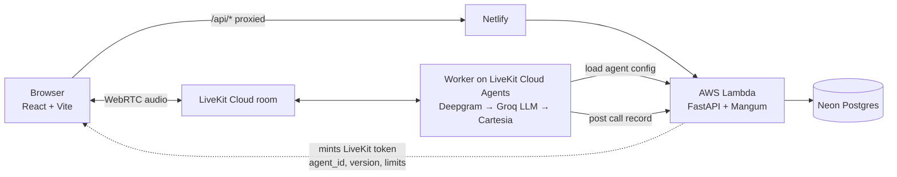

# yaprr

**Voice agents for Hindi/Hinglish phone calls (EMI reminders, sales), measured on every turn.**

**Live demo: [yapr.netlify.app/try](https://yapr.netlify.app/try)**. Talk to the agent in your browser, then open the dashboard
(read-only) to see your own call's latency, cost and outcome.

I work on lending software, and calls like "your EMI is due today" are a big part of how collections run.
Voice-agent platforms make those calls, but from the outside you only see the demo, never the numbers.
I wanted to build one end to end and answer the questions that matter in production:
*how fast does it reply, what does a minute cost, and what happens when a provider goes down?*

| | Before tuning | Now |
|---|---|---|
| Reply time, p50 (caller stops talking → agent starts) | 2.4 s | **1.5 s** |
| LLM time to first token, p50 | 1.25 s | **276 ms** |
| Agent replies cut off by the caller | 7 of 8 | **0 of 6** |
| Cost per minute (STT + LLM + TTS, no telephony) | n/a | **≈ ₹2.8** |

These come from my own test calls, recorded by the system itself (see [What's measured](#whats-measured)).
They're small samples, not a benchmark.

## What it does

- **Build an agent in the browser:** script with `{variables}`, opening line, voice, LLM plus fallbacks,
  tools (payment link, promise-to-pay, transfer, hang up), and post-call questions.
- **Publish immutable versions.** Calls record the version they ran, so v1 and v2 can be compared on real calls.
- **Talk to it** over WebRTC from the browser.
- **Dashboards** across agents, versions, outcomes and dates: latency p50/p95, ₹/min, interrupt rate, failovers.
- **Post-call dispositions:** an LLM fills the agent's own questions ("did they promise to pay? when?")
  from the transcript *and the tools that actually ran*, validated against a schema.

## Architecture



One call, step by step:

1. The browser asks the API for a test call.
2. The API signs a LiveKit token. Its room dispatches the worker with `{agent_id, version, context}`.
3. The worker loads that agent version from the API and builds the pipeline from it.
4. Each turn runs **noise cancellation → VAD → Deepgram STT → turn detector → LLM → Cartesia TTS**,
   streaming, and the caller can interrupt.
5. At hang-up the worker posts the call record (latency per stage, usage, cost, transcript), then runs dispositions and posts again.

```
apps/web     React UI: agents, script editor, talk-to-agent, calls, dashboards
apps/api     FastAPI: agents, versions, call records, stats, public demo; Alembic migrations
apps/worker  LiveKit Agents worker: pipeline, metrics, cost, safety guards, dispositions
```

## Decisions and why

**The LLM was the bottleneck, so I benchmarked instead of guessing.** `scripts/llm_bench.py` sends the real
prompt to each candidate and measures time to first token. Gemini Flash was ~1.2 s, and Groq-hosted Qwen with
reasoning turned off was ~0.3 s for this kind of short, rule-following reply. Groq became the primary model.

**Fallbacks across providers, not models.** Groq's free tier rate-limits (429) under load, and one provider's
outage takes all of its models down with it. The chain is Groq → OpenAI → Gemini through LiveKit's
`FallbackAdapter`, and every switch is counted per call (the "failover" column).
One bug I hit: I set a 4 s timeout per attempt, but Gemini rejects deadlines under 10 s, so the fallback itself
failed. The attempt timeout is now ≥ 10 s.

**Good latency numbers, but the call still felt slow.** The transcript showed why: the caller cut in on 7 of 8
replies, because each reply was 2–3 long sentences. Perceived speed is latency *plus how long the agent talks*.
I halved the prompt (1,712 → 842 tokens: instructions in compact English, only spoken lines in Devanagari, which
costs 3–4× more tokens), added brevity rules (one idea per turn, under 20 words), and sped TTS up to 1.1×.
Interrupted replies went to 0 of 6, and the smaller prompt also cut TTFT and cost.

**Cost is computed per call, not estimated per month.** The worker counts STT seconds, LLM tokens and TTS
characters, multiplies them by unit prices (providers bill in USD), and stores rupees. The dashboard shows ₹/min.

**Code guardrails, because prompts aren't enough.** A max call duration, an inactivity hang-up after two
"hello?" prompts, and a non-interruptible goodbye are all enforced in code, and every call records who ended it.

**Deploy shape.** The API is stateless HTTP, so it runs on Lambda: it scales to zero and the free tier covers it.
It uses Neon's *pooled* connection string, because each Lambda instance opens its own connection.
The worker holds a WebSocket for hours, so it runs on LiveKit Cloud Agents, not Lambda.
The web app proxies `/api/*` to Lambda, which means one origin, no CORS, and no API URL in the bundle.

**A public demo without a bill attack.** Anyone can call the demo agent, but the API enforces three limits:
2 min per call (signed into the LiveKit token, so the worker enforces it), 3 calls per visitor per day, and a
global minutes budget per day. Each call reserves its full length up front, so the worst-case daily spend is fixed.
Visitors get read-only dashboards, including transcripts; the demo page warns callers that their call is public.

## Evals

`apps/worker/evals/` runs the **real agent** (same prompt, tools, read-back gate and LLM) against 16 simulated
callers: someone who promises a date, corrects it when it's read back, has already paid, only has a keypad phone,
asks for the link on their son's number, is abusive, or is the customer's brother asking how much is owed.

- **Code checks:** the right tool ran with the right amount/date, forbidden tools didn't, every action was read
  back first, and the agent never claimed to be an AI.
- **LLM judge:** per-persona criteria that need reading, such as "didn't disclose the loan to the brother".
- **Repeats:** LLMs are random, so `--runs 3` reports pass *rates*, not one lucky run.
- **WER:** `evals/wer.py` scores STT providers (Deepgram vs Sarvam) on my own recorded clips.

```bash
python -m evals.run --runs 3                 # writes evals/results/<time>_<agent>_v<n>.md
python -m evals.wer                          # needs evals/wer_clips/clips.csv + WAVs
```

Results: <!-- EVAL_TABLE: paste evals/results/*.md here after a full run -->

## Also in the code

- **PII masking:** phone, Aadhaar, PAN, card, account numbers, emails and UPI IDs, including digits spoken as words
  ("नौ आठ सात..."), are masked in everything stored or logged. The live call isn't masked, because the agent may need
  a real number to send a link.
- **Read-back enforced in code:** the promise-to-pay and payment-link tools refuse the first call and tell the agent
  what to read back. They act only when called again with the same values *after the caller has spoken*.
  Each action also carries an idempotency key, so a retry never logs or sends twice.

## What's measured

On every call (`apps/worker/services/call_metrics.py`):

- **Latency per turn:** end of utterance, transcription, LLM first token, TTS first audio, and the total the
  caller waits (p50/p95).
- **Usage and cost:** STT audio seconds, LLM tokens per model, TTS characters → ₹ total and ₹/min.
- **Interrupted replies:** a proxy for "the agent talks too much".
- **LLM failovers and who ended the call:** user, agent, max duration or inactivity.

Biggest remaining lever: **end of utterance (~1 s of the 1.5 s)**, the time spent deciding the caller has
finished. Shorter is faster but cuts off people who pause mid-sentence. That trade-off is next.

## Run it locally

```powershell
# API (SQLite works for local dev: DATABASE_URL=sqlite:///./yaprr.db in apps/api/.env)
cd apps/api; python -m venv venv; venv\Scripts\activate
pip install -r requirements-dev.txt; copy .env.example .env
uvicorn yaprr_api.main:app --reload --port 8000

# Worker (provider keys in apps/worker/.env)
cd apps/worker; python -m venv venv; venv\Scripts\activate
pip install -r requirements-dev.txt; copy .env.example .env
python main.py download-files
$env:PYTHONUTF8=1; python main.py dev

# Web
cd apps/web; npm install; npm run dev     # http://localhost:5173
```

Tests: `pytest -q` in `apps/api` (also against Postgres via `DATABASE_URL`) and in `apps/worker`.
Deploy guide: [docs/DEPLOY.md](docs/DEPLOY.md).

## Roadmap

- [x] Agents, versions, test calls, call records
- [x] Dashboards with filters and version comparison
- [x] Live deploy (Lambda + Neon + LiveKit Cloud) and a capped public demo
- [ ] **Evals:** a golden set of scripted callers (refuses, already paid, wrong person, noisy line), scored per agent version
- [ ] **Speech-to-speech models** against the current STT → LLM → TTS pipeline, on latency, cost and Hindi quality
- [ ] Real phone calls (SIP), campaigns with retries and calling hours
- [ ] Alerts on p95 latency, cost and failover rate

## How I built it

I designed the system, picked and benchmarked the providers, ran and listened to the test calls, and debugged
the deploys. I used an AI coding assistant as a pair programmer for a large share of the code. The numbers
above come from calls I made and reviewed.

Demo agents use a fictional company ("Voltly"), and the loans in the demo are made up.
